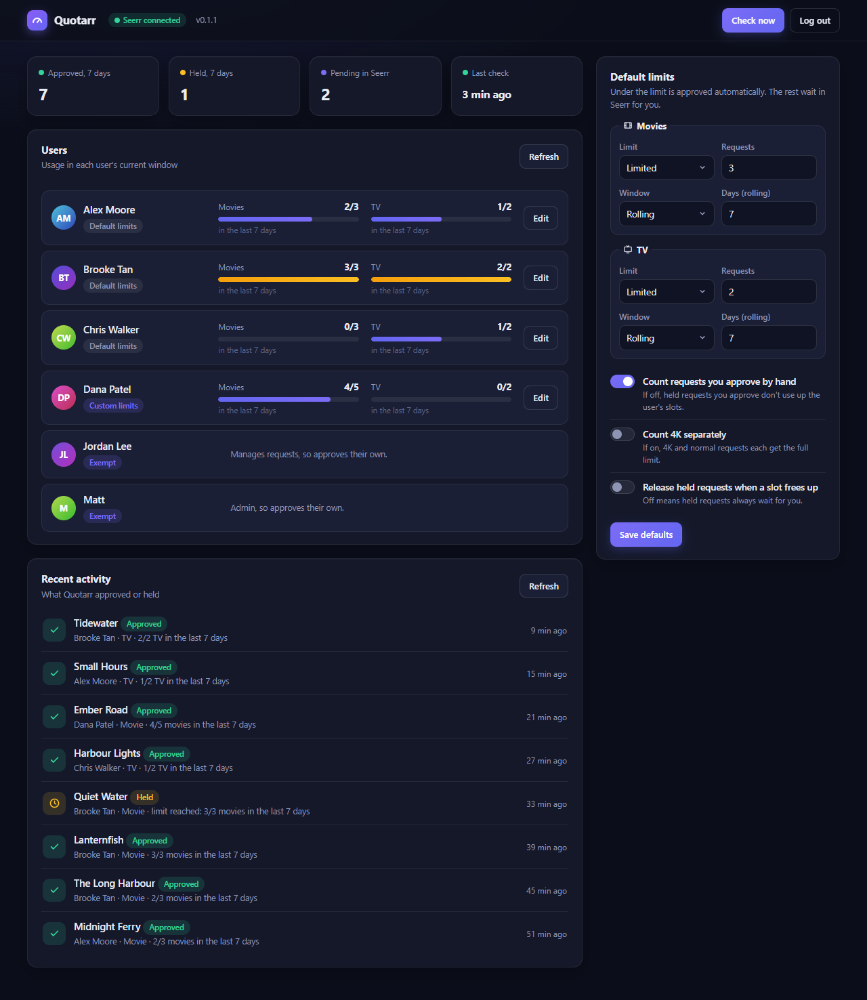
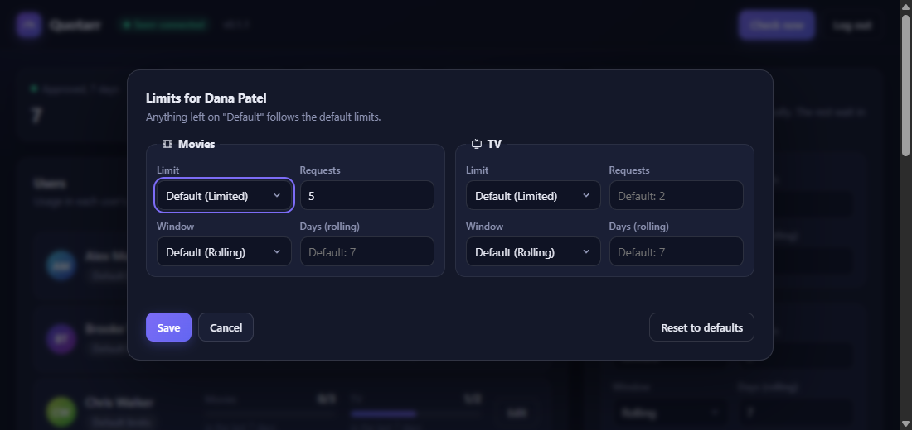
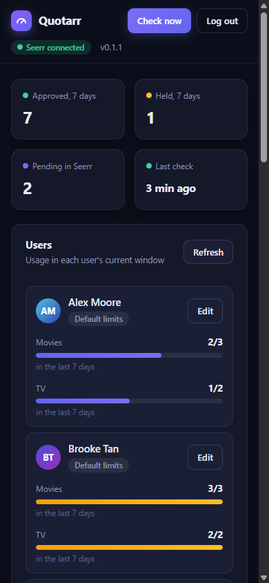

# Quotarr

Per-user auto-approval quotas for [Seerr](https://github.com/seerr-team/seerr).

Give each user a number of auto-approved requests per week (or any number of days). Anything over that isn't refused. It waits in Seerr for you to approve or decline as usual.



## Why not Seerr's own quota?

Seerr's built-in quota is a hard stop. Once users hit it, they can't request anything until the window resets. Quotarr makes it a soft limit:

- **Under the limit:** approved straight away, as if the user had Auto-Approve.
- **Over the limit:** the request is still made, but stays pending until you approve or decline it in Seerr.

## How it works

1. You take Auto-Approve away from your users in Seerr, so their requests arrive as pending.
2. Every 30 seconds Quotarr checks Seerr's pending requests, oldest first.
3. If the user is under their limit, Quotarr approves the request. If not, it leaves it pending for you and records it as **Held**.

Users with the **Admin** or **Manage Requests** permission are left alone. They approve their own.

## Install

You need Docker Compose and Seerr's API key, from **Settings → General → API Key** in Seerr.

**1. Add Quotarr to the `docker-compose.yml` that runs Seerr**, under `services:`:

```yaml
  quotarr:
    image: ghcr.io/zexusau/quotarr:latest
    container_name: quotarr
    restart: unless-stopped
    environment:
      SEERR_URL: http://seerr:5055
      SEERR_API_KEY: ${SEERR_API_KEY}
      QUOTARR_PASSWORD: ${QUOTARR_PASSWORD}
      TZ: Australia/Sydney
    volumes:
      - ./quotarr-data:/data
    ports:
      - "8484:8484"
```

- `seerr` in `SEERR_URL` is the name of your Seerr container. Change it to match yours (for example `jellyseerr`).
- If Seerr is in a different compose file or on its own Docker network, add Quotarr to that network, or use `http://<server-ip>:5055`.
- Set `TZ` to your time zone.

**2. Create a `.env` file in the same folder as `docker-compose.yml`**, or add these lines to the one you already have. Compose reads it automatically and fills in the `${...}` values:

```sh
SEERR_API_KEY=paste-your-seerr-api-key-here
QUOTARR_PASSWORD=pick-a-long-password
```

**3. Start it:**

```sh
docker compose up -d quotarr
```

**4. Open `http://<server-ip>:8484`** and log in with your `QUOTARR_PASSWORD`. Your Seerr users should be listed, with admins marked **Exempt**. If the page says Seerr is unreachable, run `docker logs quotarr` to see why.

Quotarr doesn't change anything yet: every user still has Auto-Approve, so their requests never reach it. The next step turns it on.

## Turn it on in Seerr

1. **Remove Auto-Approve.** In Seerr, open **Users**, click **Edit** next to a user, then open the **Permissions** tab. Untick **Auto-Approve**, plus **Auto-Approve Movies**, **Auto-Approve Series** and the 4K versions if they're ticked. To change several users at once, tick them on the Users page and use **Bulk Edit**.
2. **Change the default for new users.** Untick the same boxes under **Settings → Users → Default Permissions**.
3. **Leave Seerr's own quotas on unlimited.** Under **Settings → Users**, keep the global Movie and Series request limits unlimited, and don't set quota limits on individual users. Seerr counts pending requests towards its quota, so a Seerr quota will block requests before Quotarr sees them.

Tip: try it on one user first. Remove Auto-Approve from just that user, make a few requests as them, and watch **Recent activity** in Quotarr.

## Setting limits

The default limits apply to everyone. Movies and TV have separate limits, and each one has:

- **Limit**: *Limited*, *Unlimited* (approve everything), or *Off* (hold everything for you).
- **Requests**: how many get approved automatically per window.
- **Window**: *Rolling* (the last N days) or *Calendar week* (resets Monday at midnight in your `TZ`).

To give one user different limits, click **Edit** next to them. Change only what you need: anything left on "Default" follows the default limits, including later changes to them.



There are also three options:

| Option | Default | What it does |
| --- | --- | --- |
| Count requests you approve by hand | On | When you approve a held request yourself, it uses up one of the user's slots. Turn it off to approve extras without affecting their count. |
| Count 4K separately | Off | Off: 4K and normal requests share one limit. On: each gets the full limit. |
| Release held requests when a slot frees up | Off | Off: held requests wait for you. On: Quotarr approves held requests automatically once the user has room again. |

## How requests are counted

For each pending request, Quotarr counts the same user's requests of the same type (movie or TV) that:

- were **made** inside the window, and
- are **Approved** or **Completed** (Completed means it's now available).

Declined requests, failed requests (Seerr couldn't send them to Radarr or Sonarr) and other pending requests don't count. A TV request counts as one, however many seasons it asks for.

If a user makes two requests with one slot left, only the older one is approved.

## Settings

| Variable | Default | What it does |
| --- | --- | --- |
| `SEERR_URL` | `http://seerr:5055` | Where Quotarr reaches Seerr. |
| `SEERR_API_KEY` | (required) | Seerr's API key. |
| `SEERR_API_KEY_FILE` | | Read the API key from a file instead, for Docker secrets. See `docker-compose.example.yml`. |
| `QUOTARR_PASSWORD` | (none) | Password for the web page. Without it the page is turned off, but approvals still run. |
| `POLL_SECONDS` | `30` | How often to check for pending requests (minimum 5). |
| `TZ` | UTC | Your time zone, for the calendar-week reset. |
| `PUID` / `PGID` | `1000` | The user and group Quotarr runs as. It makes the `/data` folder theirs on start. |
| `WEBHOOK_TOKEN` | (none) | Protects the optional webhook (see below). |
| `PORT` | `8484` | Web port inside the container. |
| `LOG_LEVEL` | `INFO` | Set to `DEBUG` for more detail in `docker logs`. |

## Optional: instant approvals

Quotarr checks every 30 seconds. To have requests approved within a second or two, let Seerr tell Quotarr when a new request arrives:

1. Add `WEBHOOK_TOKEN: ${WEBHOOK_TOKEN}` to Quotarr's environment, put a random string in `.env` as `WEBHOOK_TOKEN=...`, and run `docker compose up -d quotarr`.
2. In Seerr, go to **Settings → Notifications → Webhook** and turn it on.
3. Set the **Webhook URL** to `http://quotarr:8484/webhook?token=<your token>`.
4. Tick **Request Pending Approval** and save.

## Updating

```sh
docker compose pull quotarr && docker compose up -d quotarr
```

Your settings, user limits and activity log are kept in `quotarr-data`.

## FAQ

**Does it work on my phone?**
Yes.



**Can my users see Quotarr?**
No. It's only for you. Users just see their request approved, or pending.

**What happens if Quotarr is down?**
Requests stay pending in Seerr and are handled as soon as Quotarr is back.

**What if I approve or decline a request before Quotarr does?**
Quotarr skips it.

**Does it work with Jellyseerr or Overseerr?**
It's built for Seerr. Jellyseerr and Overseerr use the same API, so they should work too.

**Can I put it on the internet?**
Only behind a reverse proxy with HTTPS. It's an admin page, so most people keep it on their home network.

## Licence

MIT. Quotarr isn't affiliated with the Seerr project.
